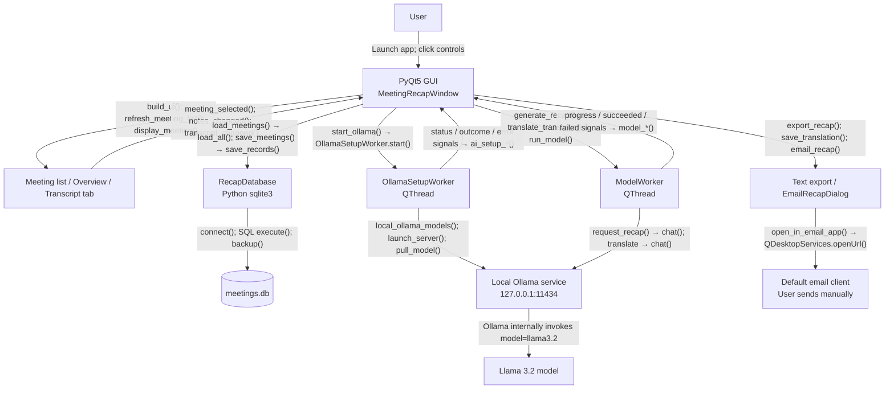
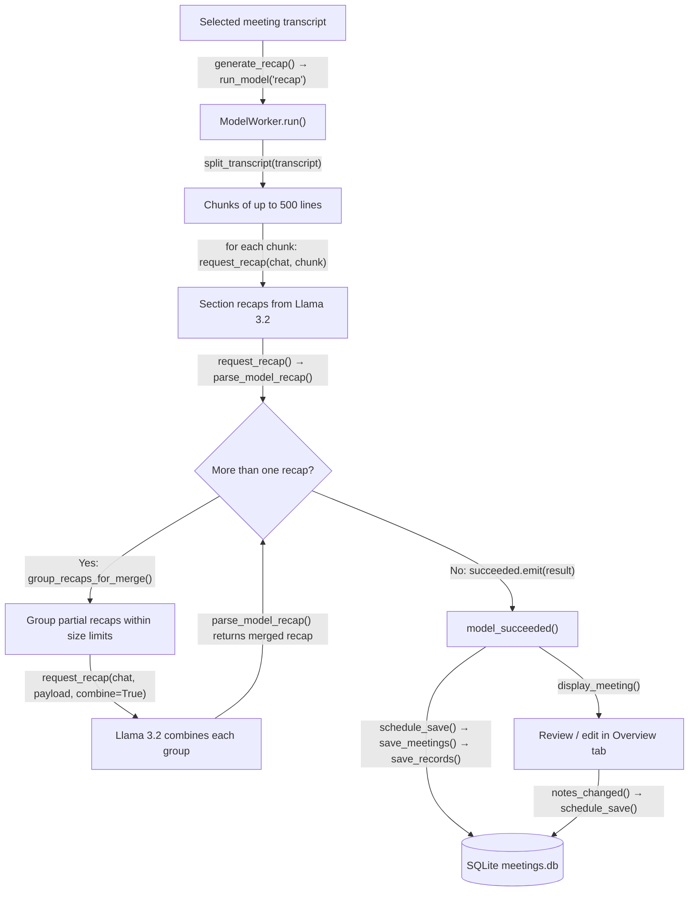

# AI Teams Meeting Transcriber

A **local-first desktop prototype** for organizing meeting transcripts, generating AI-assisted meeting recaps, tracking action items, and preparing recap emails. The application uses **PyQt5** for the graphical interface, **Ollama + Llama 3.2** for local text processing, and **SQLite** for persistent meeting storage.

> **Project status:** This README describes the functionality currently implemented in `gui.py`. The application can **import and process existing text transcripts**, but does **not yet** record/transcribe audio or retrieve meetings directly from Microsoft Teams. Microsoft Graph integration and authenticated in-app email sending are future work.

## Features

| Area | Currently implemented |
| --- | --- |
| Meeting dashboard | Left-side meeting cards showing title, date, agenda/purpose, and attendees; collapsible sidebar; selectable meeting details |
| Recap view | Editable quick summary and action items for the selected meeting |
| Transcript input | Paste text or import `.txt`, `.md`, `.srt`, or `.vtt` files as text |
| Local AI | Automatically checks/starts Ollama on app startup; detects Llama 3.2; offers an in-app model download if missing |
| Long-transcript recaps | Splits transcripts into consecutive **500-line chunks**, recaps each chunk, then combines the results in one or more passes |
| Translation | Translates an existing transcript into English using Llama 3.2, with an option to save as `.txt` |
| Local database | Stores meetings, transcripts, summaries, action items, and translations in SQLite; autosaves edits |
| Saved recaps | Search, preview, and reopen stored recaps; back up the database |
| Export and email | Export a recap as `.txt`; compose a recap email, copy it, save an `.eml` draft, or open it in the default mail application |

## Architecture

The arrows in this diagram name the **actual functions and methods in `gui.py`** that initiate the interaction or receive its result. Arrow labels using `→` denote a call sequence. The Ollama-to-model interaction is performed by Ollama itself, not by a method defined in this project.



### Arrow-by-arrow method calls

| Direction | Methods called or signals handled | What happens |
| --- | --- | --- |
| User → GUI | `QApplication(...)`, `MeetingRecapWindow()`, `window.show()`; UI events trigger methods such as `add_meeting()` and `import_transcript()` | Starts the application and receives user actions. |
| GUI → Views | `build_ui()`, `refresh_meeting_list()`, `meeting_selected()` → `display_meeting()` | Creates and updates the meeting list, summary, action items, and transcript panels. |
| Views → GUI | Qt `textChanged` / `currentItemChanged` signals → `notes_changed()`, `transcript_changed()`, `meeting_selected()` | Sends edit and selection events back to the main window. |
| GUI → Database | `load_meetings()` → `RecapDatabase(...)` / `load_all()`; `schedule_save()` → `save_meetings()` → `save_records()`; `delete_meeting()` → `delete()` | Reads, autosaves, or deletes meeting records. `save_current_recap()` also calls `save_meetings()`. |
| Saved recaps dialog → Database | `SavedRecapsDialog.refresh_results()` → `search_recaps()`; `backup_database()` → `backup()` | Searches stored recaps and creates database backups. `show_saved_recaps()` opens this dialog. |
| Database → SQLite | `RecapDatabase.connect()` → `sqlite3.connect()`; `load_all()` / `save_records()` / `delete()` / `search_recaps()` → SQL `execute()`; `backup()` → SQLite connection `backup()` | Performs file-backed SQLite operations on `meetings.db`. |
| GUI → Ollama setup worker | `start_ollama()` → `OllamaSetupWorker(...).start()`; `ai_button_clicked()` → `start_ollama()` | Checks/starts Ollama in a background Qt thread, or requests a model download. |
| Setup worker → Ollama service | `OllamaSetupWorker.run()` → `local_ollama_models()` (`GET /api/tags`); if needed `launch_server()` (`ollama serve` or opens Ollama app); if requested `pull_model()` (`POST /api/pull`) | Detects or starts the local service and optionally downloads the model. |
| Setup worker → GUI | Qt `status`, `outcome`, `error` signals → `ai_setup_status()`, `ai_setup_outcome()`, `ai_setup_error()`; `finished` → `ai_setup_finished()` | Updates the AI status indicator and controls. These are **Qt signal callbacks**, not direct worker method calls. |
| GUI → AI worker | `generate_recap()` / `translate_transcript()` → `run_model(mode)` → `ModelWorker(...).start()` | Starts recap generation or translation without blocking the UI. |
| AI worker → Ollama service | `ModelWorker.run()` → `request_recap(chat, ...)` → Ollama Python client's `chat(...)` for recap sections/merges; translation calls `chat(...)` directly | Sends the transcript text and instructions to the local Ollama service. |
| Ollama service → Llama 3.2 | Ollama loads/invokes the model selected by `model=RECAP_MODEL` (`llama3.2`) | **Internal Ollama behavior**; there is no project-defined function for this arrow. |
| AI worker → GUI | `progress.emit(...)`, `succeeded.emit(...)`, `failed.emit(...)` → `model_progress()`, `model_succeeded()`, `model_failed()`; Qt thread `finished` → `model_finished()` | Displays progress and the result; a successful recap is scheduled for saving. |
| GUI → Export / email draft | `export_recap()` → `write_export()`; `save_translation()` → `write_export()`; `email_recap()` → `EmailRecapDialog(...)` | Saves `.txt` output or opens the email composer. |
| Email dialog → Email client | `EmailRecapDialog.open_in_email_app()` → `QDesktopServices.openUrl(QUrl(...))` with a `mailto:` URL | Opens an email draft; the **user** sends it manually. `save_draft()` creates an `.eml` file, while `copy_draft()` copies the content. |

### Major components in `gui.py`

| Component | Responsibility |
| --- | --- |
| `MeetingRecapWindow` | Main window, meeting selection/editing, tabs, buttons, import/export, worker orchestration, and autosave |
| `MeetingDetailsDialog` | Collects meeting title, optional date, agenda, and attendees |
| `SavedRecapsDialog` | Searches the SQLite recap database, previews saved recaps, opens selected meetings, and creates database backups |
| `EmailRecapDialog` | Builds editable recap email drafts; validates To/Cc; copies, saves `.eml`, or opens a `mailto:` draft |
| `RecapDatabase` | Creates the SQLite schema and loads, inserts/updates, searches, deletes, and backs up meeting records |
| `OllamaSetupWorker` | Background detection/startup of the local Ollama service and optional model download |
| `ModelWorker` | Background recap generation and English translation through the Ollama Python client |
| `split_transcript`, `request_recap`, `group_recaps_for_merge` | Splitting, section summarization, JSON parsing, and multi-pass recap consolidation |

The UI and AI processing are separated with **Qt background threads** so model and startup requests do not block normal window rendering. The application is currently organized as a **single Python source file**; the components above are classes and functions within `gui.py`, not separate modules.

### Recap generation flow

This diagram expands the **recap** path into the exact functions responsible for batching, model calls, merging, and saving. Translation follows a separate path in `ModelWorker.run()`.



**Implementation detail:** Merge groups containing only one recap are carried forward without another model request. Autosaving uses a 400 ms `QTimer`, so `schedule_save()` does not immediately write to SQLite; its timer triggers `save_meetings()`.

- Each section produces a JSON object with `summary` and `action_items`.
- The application merges section recaps into a single overall summary and task list, attempting to preserve owners/deadlines and remove repeated items.
- For very long transcripts, partial recaps are merged in several passes. Current code limits a merge request to **8 recaps** and targets a **18,000-character** combined input budget.
- Recap requests use a configured Ollama context of **16,384 tokens**. A single 500-line chunk with unusually long lines may still exceed the context limit.
- If recap generation fails, the GUI shows an error rather than replacing the existing saved recap with a partial result.
- **Translation is separate:** it currently sends the full transcript in one request and does **not** use the 500-line recap batching.

## Local installation

### Prerequisites

1. **Python 3** with `venv` and `pip` available.
2. **Ollama** installed locally from <https://ollama.com/download> (Windows or macOS). The GUI can start Ollama after installation, but does not install the Ollama application itself.
3. The project code, including **`gui.py`**. If cloning a GitHub repository, substitute your repository's actual URL in the commands below.
4. An internet connection **for the initial package and Llama 3.2 model download**. Normal recap and translation processing uses the local Ollama service.

Python packages used by `gui.py`:

```text
PyQt5
ollama
```

SQLite (`sqlite3`), JSON, email draft utilities, and subprocess/process management are provided by Python's standard library. No separate SQLite server is needed.

### Windows (PowerShell)

From your project directory:

```powershell
cd path\to\AITeamsMeetingTranscriber

# Create project virtual environment (once)
py -m venv .venv

# Install dependencies into THIS environment
.\.venv\Scripts\python.exe -m pip install PyQt5 ollama

# Or, if your project has a requirements.txt:
# .\.venv\Scripts\python.exe -m pip install -r requirements.txt

# Start the desktop GUI
.\.venv\Scripts\python.exe gui.py
```

If your repository is not yet on the computer, first clone it with Git:

```powershell
git clone https://github.com/OWNER/REPOSITORY.git
cd REPOSITORY
```

Replace the placeholder GitHub address with the real repository URL. Do **not** copy another computer's `.venv` folder; create a fresh one on each machine.

### macOS (Terminal / zsh)

From your project directory:

```bash
cd ~/Documents/AITeamsMeetingTranscriber

# Create project virtual environment (once)
python3 -m venv .venv

# Install dependencies into THIS environment
./.venv/bin/python -m pip install PyQt5 ollama

# Or, if your project has a requirements.txt:
# ./.venv/bin/python -m pip install -r requirements.txt

# Start the desktop GUI
./.venv/bin/python gui.py
```

If you prefer a different project directory (for example, `~/Developer/AITeamsMeetingTranscriber`), change the `cd` command accordingly.

### First run: local Llama 3.2

1. Launch `gui.py`. The dashboard opens and begins checking the local Ollama service in the background.
2. If Ollama is installed but not running, the application attempts to start it automatically.
3. If the header says **AI: Model not installed**, click **Download Llama 3.2**. This step downloads model files and requires internet access.
4. When the header says **AI: Llama 3.2 ready**, select a meeting containing a transcript and click **Generate recap · Llama 3.2** or **Translate transcript to English**.
5. If startup fails, use **Retry AI**. The app expects Ollama at `http://127.0.0.1:11434` (the built-in default); it does not currently discover custom `OLLAMA_HOST` configurations.

You generally **do not need to run `ollama run llama3.2` in a separate terminal**. Ollama loads the model when an actual recap or translation request is made. The Ollama service may remain running after you close the GUI.

## Using the application

1. **Create or import a meeting.** Click **+ New meeting** and enter its details, or choose **Import transcript** for an existing text-based transcript. You can also paste transcript text in the **Transcript & translation** tab.
2. **Select the meeting.** Meeting cards appear in the left sidebar with title, date, agenda, and attendees. Use **Hide meetings** to collapse that sidebar.
3. **Generate a recap.** When Llama 3.2 is ready, click **Generate recap · Llama 3.2**. For long transcripts, progress shows section summaries and merge passes.
4. **Review the result.** The **Overview** tab displays an editable summary and one action item per line. Manual changes are autosaved after a short delay; **Save recap** explicitly saves the selected recap.
5. **Reopen saved work.** Click **Saved recaps...** to search, preview, and reopen a previously saved recap. Use the backup action there to save a copy of the database.
6. **Export or draft an email.** **Export recap** produces a `.txt` file. **Email recap** prepares an editable To/Cc/subject/body draft; the user must still send it from an email client.

**Import note:** `.srt` and `.vtt` files are loaded as text; the current importer does not perform timestamp-aware parsing or speaker diarization.

## Local data and file layout

A typical working directory looks like this:

```text
AITeamsMeetingTranscriber/
├── gui.py                 # PyQt5 application and business logic
├── requirements.txt       # Recommended dependency list (if present)
├── .gitignore             # Recommended Git exclusions (if present)
├── meetings.db            # Created automatically; local SQLite database
├── meetings.json          # Optional legacy data; imported only on first DB creation
└── .venv/                 # Local Python virtual environment; do not commit
```

### SQLite storage

The application creates **`meetings.db` next to `gui.py`**. Its `meetings` table currently includes:

- Meeting ID, title, meeting date, agenda, and attendees.
- Original transcript, generated/edited summary, action items, and English translation.
- `extra_json` for unknown meeting fields, leaving room for later integration.
- Display order and creation/update timestamps.

Attendees and action items are serialized as JSON strings in the SQLite table. Meeting details can remain blank because a permanent Teams meeting format has **not** yet been defined.

Changes to meeting fields are autosaved to SQLite after approximately **400 ms** of inactivity. The **Save recap** action also writes the current recap explicitly. **Delete** removes a meeting record from the local database after confirmation.

**Migration behavior:** When `meetings.db` does not exist, the app imports any existing `meetings.json` records once, without modifying the JSON file. If neither database nor JSON exists, the app starts with two clearly labeled demonstration meetings. Once the database exists, `meetings.json` is not automatically imported again.

### Privacy and Git

Meeting transcripts and recaps are stored **locally but unencrypted** in `meetings.db`. Treat the database and backups as potentially sensitive. The local Ollama API processes recap/translation requests on the user's machine; no Microsoft Teams or cloud transcript integration is implemented in this version. Email handoff passes the draft to the operating system's configured email handler, which may use a cloud-based email service when the user sends it.

Add at least the following to `.gitignore`:

```gitignore
.venv/
__pycache__/
*.pyc
.env
meetings.db*
meetings.json
```

Do not commit real transcripts, recordings, or exported recaps to a public repository. Back up `meetings.db` before replacing the application or performing major upgrades.

## Configuration and limitations

Current constants near the top of `gui.py`:

| Setting | Current value | Purpose |
| --- | --- | --- |
| `RECAP_MODEL` | `llama3.2` | Local model used for recaps and translations |
| `OLLAMA_API_URL` | `http://127.0.0.1:11434` | Expected local Ollama service |
| `RECAP_LINES_PER_CHUNK` | `500` | Maximum transcript lines per initial recap request |
| `RECAP_CONTEXT_TOKENS` | `16384` | Requested context for section/merge recap calls |
| `MAX_MERGE_RECAPS` | `8` | Maximum number of partial recaps per merge group |
| `MAX_MERGE_CHARS` | `18000` | Target maximum serialized text size per merge group |

**Not implemented yet:** direct Microsoft Teams/Graph API retrieval, audio transcription (e.g. Whisper integration), user accounts, authenticated API-based email sending, encrypted database storage, full-transcript chunking for translation, or a packaged standalone desktop installer. These are potential roadmap items, **not current capabilities**.

AI output may omit, misinterpret, or inaccurately combine details. **Review summaries and action items before sharing them**.

## Troubleshooting

**PyQt5 is installed globally but not found by this project**  
Install packages using the virtual environment's exact Python path shown above. To verify:

```bash
# macOS
./.venv/bin/python -m pip show PyQt5 ollama
```

```powershell
# Windows
.\.venv\Scripts\python.exe -m pip show PyQt5 ollama
```

**Ollama is unavailable or the model is missing**  
Install the Ollama desktop application, then use **Retry AI** or **Download Llama 3.2** in the GUI. On a machine with the Ollama CLI available, `ollama list` can confirm downloaded models. Check whether another service is occupying port `11434`.

**macOS: `Could not find the Qt platform plugin "cocoa"`**  
This is a Qt/PyQt5 runtime issue, not a recap-model error. Try a fresh virtual environment and reinstall `PyQt5`. Check for conflicting `QT_QPA_PLATFORM_PLUGIN_PATH` / `QT_PLUGIN_PATH` environment variables. Avoid copying virtual environments from another machine.

**Very long transcripts fail during recap**  
Recaps use 500-line batches and multi-pass merging, but 500 unusually long lines can still overflow the model context. Consider shortening individual lines or reducing `RECAP_LINES_PER_CHUNK`. English translation currently does not use this batching approach.

**Saved meeting data is missing**  
Check that you launched the intended copy of `gui.py`; `meetings.db` is resolved relative to the file's directory, **not** the terminal's current directory. Restore a backup if the database was moved or deleted.

---

*Documentation based on the current local PyQt5/SQLite/Ollama `gui.py` prototype. Update this README as the Teams data format and integrations are finalized.*
